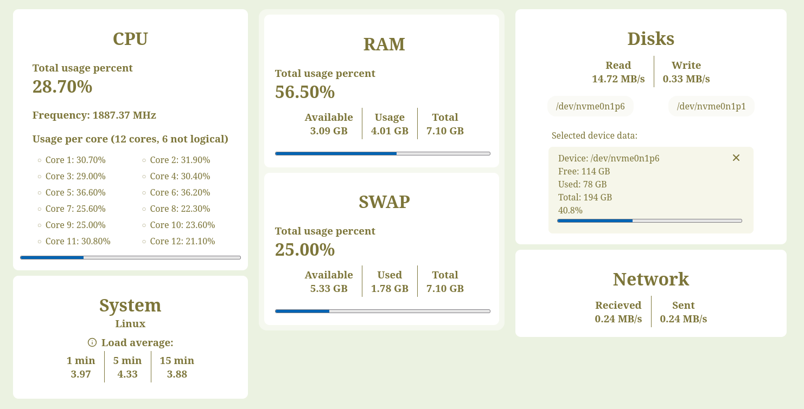

# marconiDASH
A web dashboard to monitor PC stats. It offers CPU, RAM, SWAP, Disks, Network monitoring and more. Every info is showed considering clarity the main target, to make the monitoring flow with ease.


## Screenshots



## Why I made it

Almost every new pc owner starts dealing with performance and optimization, and sometimes getting in front of the task manager is just too much, so ****marconiDASH**** does it all, while maintaining a clean interface that everyone can understand.

I also built this project because everytime I was dealing with my homelab I felt the need of something to quickly read the statistics. Just a quick watch, not a deep analysis. This really saves me!

## Features
****marconiDASH**** uses python, with ***psutil*** as the main working library, and Flask to host a webpage and update data. All the info is passed by a JavaScript request to Flask endpoints. 

You can access the web dashboard from everywhere, as long as you're connected to the same network as the server.
### Stats you can monitor 
With ****marconiDASH****, you can monitor:
- CPU (Usage percent, frequency, core number, usage percent per core)
- System (OS and 1m, 5m and 15m load average)
- RAM (Total usage percent, available, used, total)
- SWAP (Total usage percent, available, used, total)
- Disks (Devices name and free, used and total GB for each one)
- Network (Received MBs and sent MBs)
## Installing and running

1. Go to the releases page
2. Download the .exe or linux file
3. Run the .exe or linux file

### Compile from the source
Make sure you have the dependencies installed:
- Psutil
- Flask

```
git clone https://github.com/FeDevXYZ/marconiDASH.git
cd marconiDASH
python main.py
```
## Known issues
- ***On Windows some data won't get fetched***. CPU usage percent, frequency, core number and percents will return default values most of the time. This is because Windows doesn't expose endpoints to get that data. Psutil tries to generate coherent data, but it usually fails. 
- ***On Windows load average won't be precise at the start of the script***. This is because Windows doesn't expose endpoints to get that data. Psutil tries to generate coherent data, but it needs some minutes to average data and get a good result.
- ***Web interface doesn't work on tablets and phone***. It isn't coded yet! This is included in the internal roadmap. 
